# Lab8Web - PHP dan Database MySQL

**Nama:** Naifah Alya Kamilah

**NIM:** 312510193

**Kelas:** I251B

**Mata Kuliah:** Pemrograman Web (Praktikum 9)

## Tujuan Praktikum

1. Memahami konsep dasar database.
2. Memahami konsep dasar CRUD menggunakan PHP.
3. Membuat program CRUD sederhana menggunakan PHP dan MySQL.


## Cara Menjalankan

1. Jalankan **Apache** dan **MySQL** melalui XAMPP Control Panel.
2. Buka `http://localhost/phpmyadmin/`, lalu buat database `latihan1` dan tabel `data_barang` (perintah SQL ada pada Langkah 2 dan 3 di bawah).
3. Letakkan folder `lab8_php_database` di `C:\xampp\htdocs\`.
4. Buka `http://localhost/lab8_php_database/` di browser.

## Langkah Kerja

### 1. Menjalankan Apache dan MySQL

Apache dan MySQL dijalankan melalui XAMPP Control Panel. Keduanya berstatus hijau, dan MySQL berjalan di port 3306.

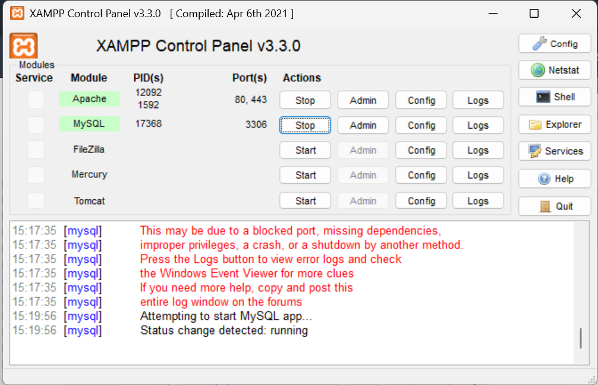

### 2. Membuat Database

Database `latihan1` dibuat lewat phpMyAdmin (tab SQL) dengan perintah:

```sql
CREATE DATABASE latihan1;
```

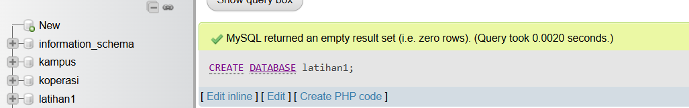

### 3. Membuat Tabel

Tabel `data_barang` dibuat di dalam database `latihan1`. Kolom `id_barang` menjadi primary key dengan `auto_increment`.

```sql
CREATE TABLE data_barang (
  id_barang int(10) auto_increment Primary Key,
  kategori varchar(30),
  nama varchar(50),
  gambar varchar(100),
  harga_beli decimal(10,0),
  harga_jual decimal(10,0),
  stok int(4)
);
```

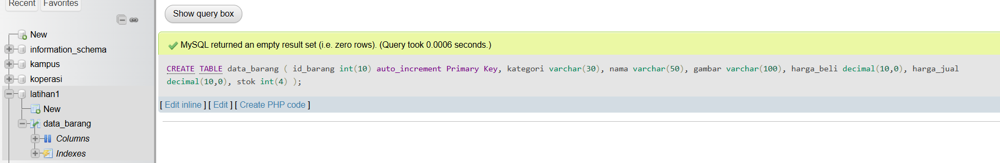

Struktur tabel yang terbentuk:

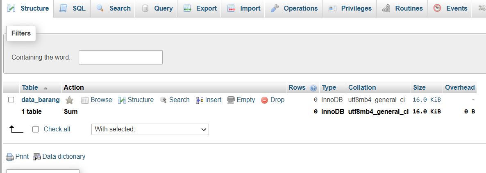

### 4. Menambahkan Data Awal

Tiga data awal dimasukkan dengan `INSERT INTO`, lalu dicek menggunakan `SELECT * FROM data_barang;`.

```sql
INSERT INTO data_barang (kategori, nama, gambar, harga_beli, harga_jual, stok)
VALUES ('Elektronik', 'HP Samsung Android', 'hp_samsung.jpg', 2000000, 2400000, 5),
('Elektronik', 'HP Xiaomi Android', 'hp_xiaomi.jpg', 1000000, 1400000, 5),
('Elektronik', 'HP OPPO Android', 'hp_oppo.jpg', 1800000, 2300000, 5);
```

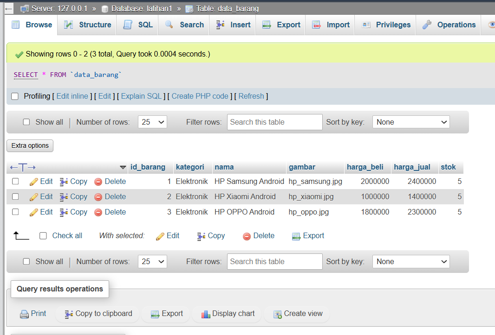

### 5. Menyiapkan Folder Proyek

Folder `lab8_php_database` dibuat di `C:\xampp\htdocs\`, dengan subfolder `gambar` untuk menyimpan gambar hasil upload.

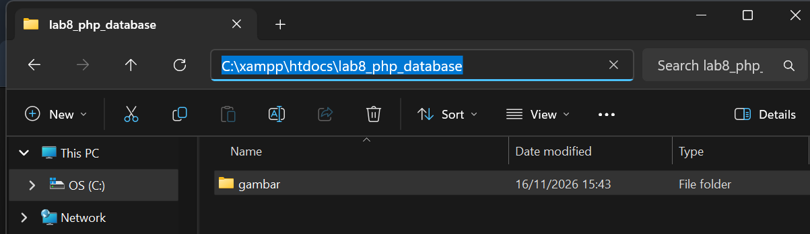

Folder diakses melalui `http://localhost/lab8_php_database/` dan masih kosong karena belum ada file PHP.

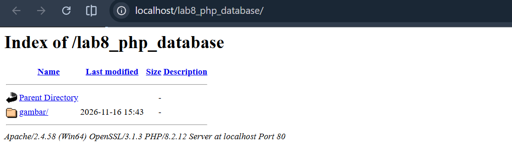

### 6. File Koneksi Database (`koneksi.php`)

File ini menghubungkan PHP ke MySQL memakai `mysqli_connect()` dengan host `localhost`, user `root`, password kosong, dan database `latihan1`. Jika koneksi gagal, program berhenti (`die()`) dan menampilkan pesan error. Pesan "Koneksi berhasil" diaktifkan sementara untuk pengujian, lalu dinonaktifkan lagi agar tidak muncul di halaman lain dan tidak mengganggu `header()` pada proses redirect.

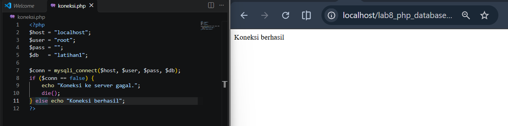

### 7. Menampilkan Data / Read (`index.php`)

Data diambil dengan `SELECT * FROM data_barang`, lalu ditampilkan dalam tabel HTML menggunakan perulangan `while` dan `mysqli_fetch_array()`. Setiap baris memiliki link **Ubah** dan **Hapus**, serta ada link **Tambah Barang** di atas tabel. Jika tabel kosong, tampil pesan "Belum ada data".

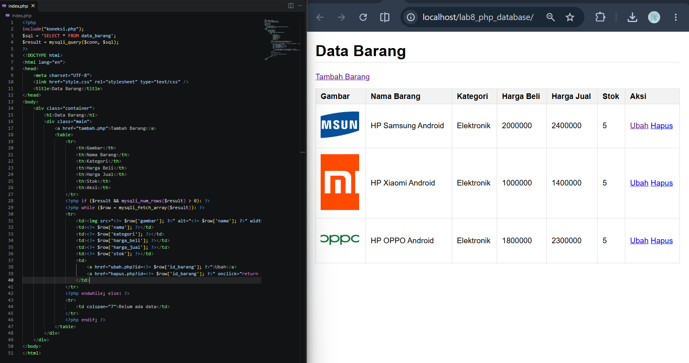

### 8. Menambah Data / Create (`tambah.php`)

Form berisi nama, kategori, harga jual, harga beli, stok, dan upload gambar (`enctype="multipart/form-data"`). Setelah disubmit, gambar dipindahkan ke folder `gambar/` dengan `move_uploaded_file()`, lalu data disimpan dengan `INSERT INTO` dan halaman dialihkan ke `index.php`.

Form kosong:

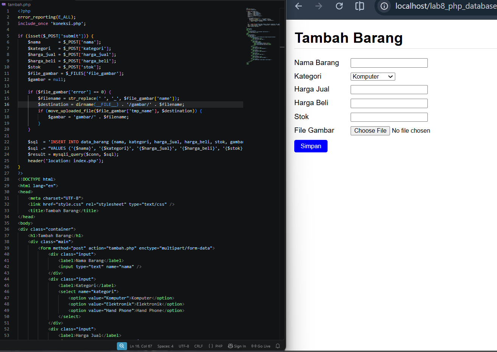

Form diisi (Dyson Hair Dryer):

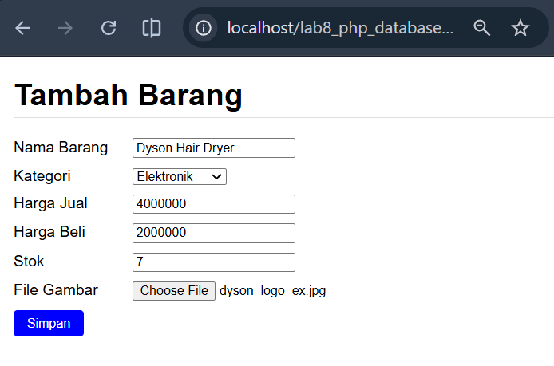

Hasil setelah disimpan, data baru muncul lengkap dengan gambarnya:

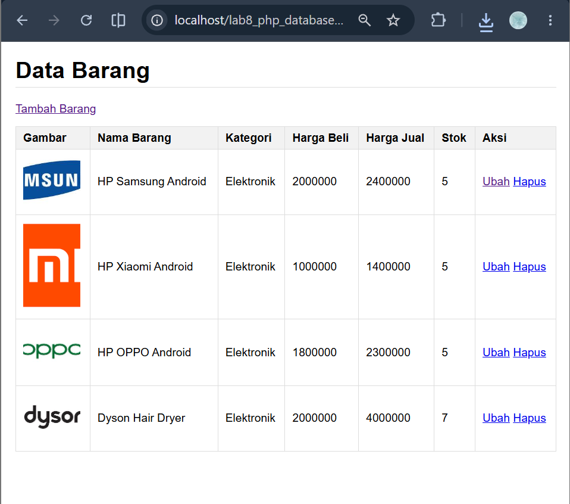

### 9. Mengubah Data / Update (`ubah.php`)

Data lama diambil berdasarkan `id` dari URL (`$_GET['id']`) lalu ditampilkan pada form. Fungsi `is_select()` dipakai agar kategori yang tersimpan terpilih otomatis. Saat disimpan, data diperbarui dengan `UPDATE ... WHERE id_barang`. Gambar hanya diganti jika pengguna memilih file baru.

Form ubah (stok HP Samsung Android masih 5):

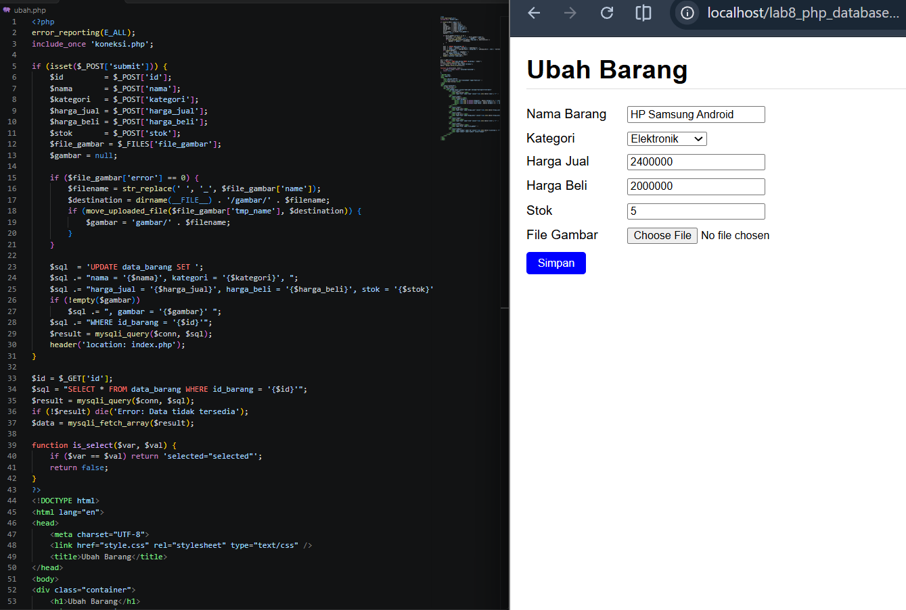

Hasil setelah diubah (stok menjadi 3):

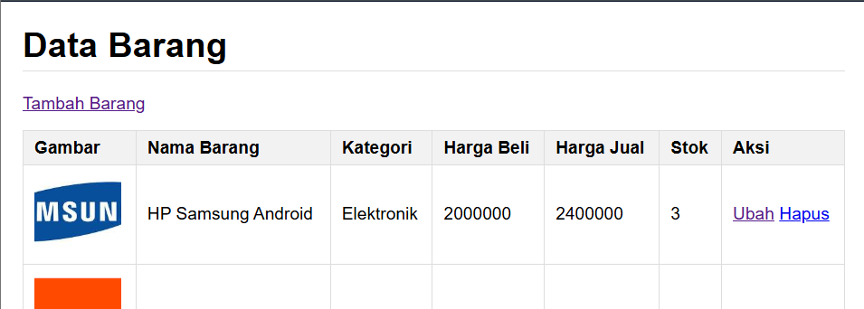

### 10. Menghapus Data / Delete (`hapus.php`)

Link **Hapus** mengirim `id` ke `hapus.php` (contoh `hapus.php?id=1`), yang menjalankan `DELETE FROM data_barang WHERE id_barang`, lalu mengalihkan kembali ke `index.php`. Sebelum data dihapus, muncul dialog konfirmasi JavaScript.

Kode `hapus.php`:

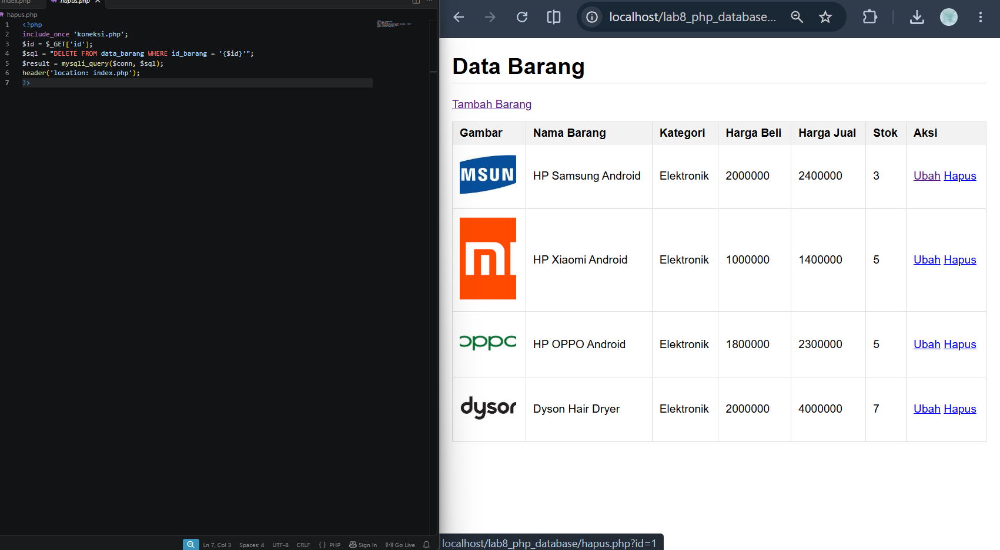

Dialog konfirmasi:

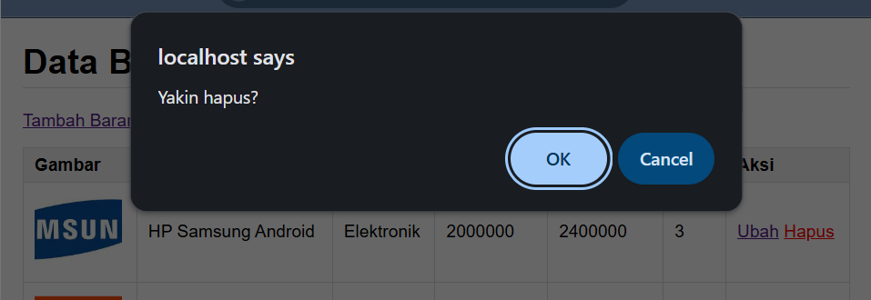

Hasil setelah dihapus (HP Samsung Android hilang dari daftar):

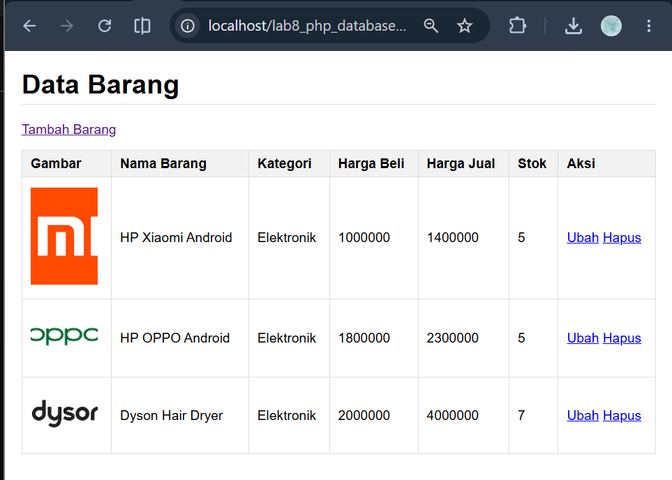

## Perbaikan dari Modul

Beberapa bagian kode pada modul disesuaikan agar program berjalan benar:

| No | Perbaikan | Keterangan |
|---|---|---|
| 1 | Urutan kolom Harga Beli dan Harga Jual di `index.php` | Pada modul urutannya tertukar |
| 2 | Kolom **Aksi** di `index.php` | Berisi link Ubah dan Hapus (modul hanya menampilkan id) |
| 3 | `multipart/form-data` di `ubah.php` | Pada modul tertulis `multipart/formdata` sehingga upload gambar gagal |
| 4 | Fungsi `is_select()` di `ubah.php` | Setiap opsi dibandingkan dengan nilainya sendiri, bukan selalu `'Komputer'` |
| 5 | File `style.css` | Dipanggil di semua halaman tetapi tidak disediakan di modul |

## Catatan Keamanan

Kode pada praktikum ini masih rentan terhadap **SQL injection** karena input pengguna langsung dimasukkan ke dalam query. Solusinya adalah memakai *prepared statements* (`mysqli_prepare()`) dan memvalidasi tipe file yang diupload.

## Kesimpulan

Praktikum ini membuktikan bahwa operasi CRUD (Create, Read, Update, Delete) dapat dibuat menggunakan PHP dan MySQL. Data barang berhasil ditambah, ditampilkan, diubah, dan dihapus melalui antarmuka web.